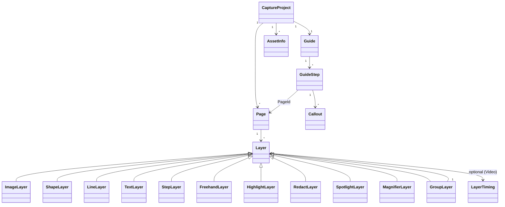

# Datenmodell

Code: `src/CaptureDoc.Core/Model/` (`Project.cs`, `Layers.cs`, `Geometry.cs`, `PageOperations.cs`).

- **CaptureProject**: Id, Titel, `Revision` (Konflikterkennung), Seiten, Anleitung, Asset-Index, Exportprofile, Einstellungen.
- **Page**: eine bearbeitbare Bildfläche (Breite/Höhe, Hintergrundfarbe, Ebenen unten→oben). Screenshot-Projekt = 1 Seite, Anleitung = N Seiten.
- **Layer** (Basis): `Id`, `Name`, `Visible`, `Locked`, `Opacity`, `Timing?`. Jede Annotation = eigene Ebene.
- **ImageLayer** mit `IsBackground`: das Originalbild. Wird nie verändert; Zuschnitt verschiebt nur die Ebene (nichtdestruktiv).
- **StepLayer**: `Number` + `AutoNumber`. `PageOperations.RenumberSteps` nummeriert in Erstellungsreihenfolge; manuelle Nummern bleiben, folgende Auto-Nummern setzen danach fort.
- **RedactLayer**: `Blackout` / `Pixelate` / `Blur`; immer 100 % deckend gerendert (Deckkraft wird ignoriert, damit nichts durchscheint).
- **LayerTiming / Keyframe**: Start/Ende/Keyframes für Phase 7 – im Modell und Dateiformat vorhanden, noch ohne UI.
- **Assets**: inhaltsadressiert (SHA-256 = Id) im `AssetStore`; doppelte Bilder werden nur einmal gespeichert.

## Serialisierung
`System.Text.Json`, camelCase, Enums als Strings, Polymorphie über Feld `"type"` (`image`, `shape`, `line`, `text`, `step`, `freehand`, `highlight`, `redact`, `spotlight`, `magnifier`, `group`). Farben `#RRGGBBAA`. Container: [[ADR-003 Projektformat]].

## Auto-Save und Wiederherstellung
Alle N Sekunden (Standard 60) wird ein geändertes Projekt nach `Data/Cache/Recovery/<projektId>.capturedoc` gesichert (+ `.origin` mit Originalpfad). Nach einem Absturz fragt der nächste Start: Wiederherstellen / Verwerfen / Später. Wiederhergestellte Projekte zeigen wieder auf die Originaldatei und übernehmen deren Revision (kein falscher Konflikt).
