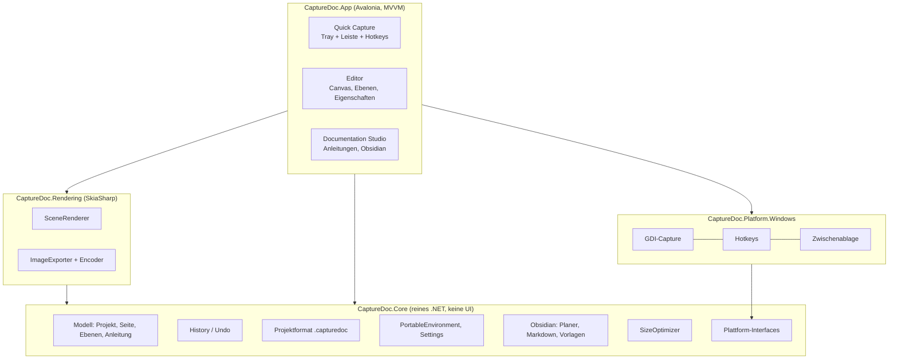

# Architektur-Überblick

## Schichten
| Projekt | Aufgabe | Abhängigkeiten |
|---|---|---|
| `CaptureDoc.Core` | Datenmodell, Ebenen, Undo, Projektformat, portable Pfade/Settings, Export-Profile, Größenoptimierung, Obsidian-Export (Planung + Markdown) | nur BCL |
| `CaptureDoc.Rendering` | Szene → Pixel (Editor **und** Export), Encoder PNG/JPEG/WebP, Schwärzung „einbrennen“ | Core, SkiaSharp |
| `CaptureDoc.Media` | Video/GIF über externes FFmpeg: Aufnahme (Segmente, Pause), MP4/GIF-Export mit Größenoptimierung, Frames | Core |
| `CaptureDoc.Platform.Windows` | Capture (GDI), Fensterliste, globale Hotkeys, Bild-Zwischenablage | Core (P/Invoke, keine UI) |
| `CaptureDoc.App` | Avalonia-UI: Quick Capture, Auswahl-Overlay, Editor, Studio | alle |
| `tests/*` | xUnit | – |

## Prinzipien
- **Ein Renderer** für Vorschau und Export → was man sieht, wird exportiert.
- **Kern ohne UI und ohne OS-Abhängigkeit** → testbar, auf allen OS identisch (gemeinsame Projektdateien).
- **Adapter je OS** hinter Interfaces in `Core/Platform` ([[Platform-Integration]]).
- **Nichtdestruktiv:** Originalbild bleibt unverändert; Crop/Resize/Annotationen sind Ebenen- bzw. Seiteneigenschaften ([[Layer-System]]).
- Keine Netzwerkzugriffe im gesamten Code (keine Telemetrie, keine Uploads).

Weiter: [[Technology-Stack]] · [[Data-Model]] · [[Platform-Integration]] · Entscheidungen in `Decisions/`.
